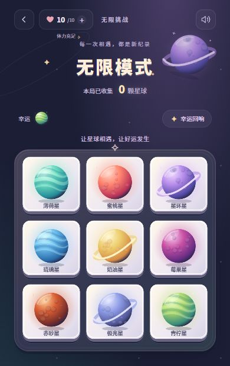

# 按钮音效与棋盘清晰度

2026-11-25。修复手机反馈的两点：按钮缺少统一点击反馈；棋盘中的图案与文字比其他位置模糊、有锯齿。

## 按钮反馈

复用现有 Web Audio 合成器的短点击音，统一音色与音量。通过委托监听覆盖当前及动态生成的按钮，包括开始、返回、下一步、设置、弹窗、选牌、广告入口、发牌与模式切换；拆包 iframe 中的原生按钮使用相同入口。点击文字、图片或 SVG 图标都只触发一次，禁用按钮不播放。

点击声遵循原音效开关，静音期间不播放；重新开启音效时补一次确认声。翻牌、撕包、奖励等事件继续使用各自音效，点击音不会重新引入卡片落位噪声。

代码：`src/button-feedback.ts`、`src/card-sounds.ts`、`src/main.ts`、`src/blessing-pack.ts`。

## 棋盘清晰度

原棋盘始终使用 360×360 的画布，再缩放到手机显示。高分屏需要更多物理像素，仅开启 `antialias` 不会补足画布分辨率。Phaser 4 当前版本也没有旧版的游戏级 `resolution` 配置，因此提高实际画布尺寸，并通过相机保持 360 单位的逻辑坐标。

- 按实际显示宽度与设备像素密度计算画布尺寸，上限 1080×1080、像素密度上限 3；容器尺寸改变时重新适配。
- SVG 图案以 384×384 栅格化，奶娃继续使用原有 384×384 PNG。
- 卡框、角色和名称统一在 324×324 卡面上预先合成，绘制后复用。一次绘制一张完整卡，减少透明叠层和文字的重复渲染；翻面过程与棋盘落定状态使用同一张卡面。
- 发牌、翻转、收集及棋盘格仍按原 360 单位布局定位，不随物理像素尺寸放大偏移。

新增皮肤继续通过主题注册表接入；保持高质量 SVG，位图角色建议至少 384×384，不要先缩小再放大。高分辨率不会修复源图本身的抠图或白边，素材质量仍需单独检查。

代码：`src/board-resolution.ts`、`src/board.ts`。

## 验收

已有 50 项自动测试通过，TypeScript 与生产构建通过。浏览器验证覆盖：

- 经典、萝卜、奶茶、奶娃四套皮肤各九种图案；390 像素宽布局及 320 像素窄屏。
- 模拟三倍像素密度时，324 像素宽棋盘使用 972×972 画布；缩小后 266 像素宽棋盘使用 798×798 画布，逻辑坐标保持 360。
- 首页设置与动态弹窗只播放一次点击声；静音后计数不增加；重新开启时有反馈。
- 开始、拆包、任选、下一步、幸运选择、起始牌确认与发牌的完整流程；九张高清卡依次翻面。

清晰度预览：开发服务 `?previewBoard=1&previewUniverse=classic&previewBoardDpr=3`。可替换其他主题，或修改 `previewBoardDpr` 检查不同像素密度。预览使用独立内存数据，不保存玩家进度，生产构建不启用。

以上为浏览器和模拟像素密度验证，实际手机的扬声器输出与持续帧率仍需真机复测。
