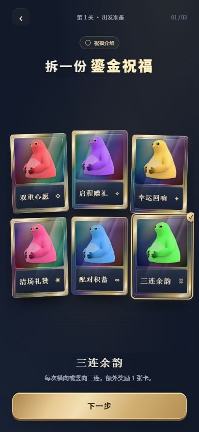
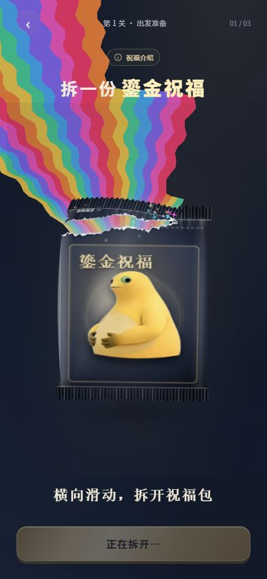
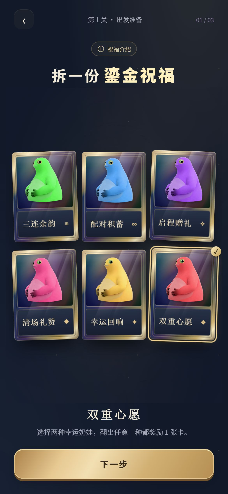

# 祝福拆包性能优化

2026-11-25。针对手机撕包、六卡出场和翻面后虹彩卡面卡顿，保留当前演出的画质、数量和时序，调整工作发生的位置与绘制方式。

## 调整

1. **提前准备六张卡。** 原先在撕裂结束、爆开、粒子和出卡同时发生时创建卡片 DOM。现在在拆包准备期间创建、加载图案并测量尺寸，保持隐藏，撕断后直接复用；起飞的位置按当时包体状态更新。没有提前展示卡片或提前翻面。
2. **出场期间不读取卡片布局。** 卡片尺寸在准备阶段或窗口调整时统一读取，环绕和落位沿用原来的弹簧、轨迹和时间，不再逐张读取 `offsetWidth`。
3. **缓存反光图层。** 原有圆形反射、椭圆清漆高光和斜向扫光保留相同颜色、透明度、位置与蒙版，通过移动、缩放已绘制的渐变图层更新。虹彩与闪粉仍保留；动态变量只写在虹彩图层上，避免同时让文字、边框和角色重新计算继承样式。
4. **限定包体绘制范围。** 包身使用绘制隔离，在操作前提示浏览器提前准备两面包体的裁切图层，保留原轮廓与封条细节。
5. **避免重复调度音量。** 静音状态未改变时不反复向 Web Audio 调度相同音量曲线；撕裂声、按钮声、翻面声及静音行为保持一致。

本次没有进一步降低光流采样、粒子数量、封条分段、卡面更新频率或素材分辨率，也没有延长动画来掩盖停顿。现有手机效果档位和减少动态效果偏好继续适用。

## 验证

- 51 项自动测试通过，TypeScript 与生产构建通过。新增几何测试覆盖反射中心、最远角半径、扫光位移与透明度，检查转换前后的计算一致性。
- 390×844 浏览器布局检查四套皮肤：准备时六张卡隐藏，出场后仍仅六张；免费翻一张后其余五张保留背面；任选后六张依次翻开。
- 返回幸运选择后重回祝福，已翻结果和选择保留，仍仅六张卡；无重复卡片、未见脚本错误。
- 虹彩、闪粉、扫光、角色浮出、六卡环绕、粒子和全屏光流继续保留。

这是代码与浏览器验证，不是实际手机的帧率测量，不能据此承诺所有机型稳定达到某个帧率。需要在用户原手机上复测同样三段，确认剩余瓶颈。

修改入口：`public/prism-blessing/engine.js`、`optics.js`、`integration.css`、`sound.js`。开发检查可用 `?previewUniverse=naiwa&previewBlessing=1&previewMobileEffects=1`；可替换其他主题。

## 2026-11-28：只优化撕开到六卡出场

安卓、苹果均反馈出包时仍卡，翻面和落定后的效果已正常。本轮保持反光代码、粒子数、封条分段、出卡轨迹和动画时长，针对同时出包的渲染负担调整：

- 手机光流用单个高分辨率 Canvas 绘制原有 32 条带状多边形，保持原采样点、渐变、全屏范围与 10 个发光粒子，不再每帧构造并让浏览器解析 32 条 SVG 路径字符串。桌面保留 SVG、泛光与蒙版；Canvas 不可用时回退原实现。
- 未翻开的卡正面及立体角色在手机上暂不生成绘制图层，翻面启动时恢复；避免六张背面出包时同时分配几十个不可见的虹彩、清漆和角色图层。正面 DOM、素材和光学效果保留。统一卡背也不再夹带已经隐藏的上游复杂 SVG 装饰。
- 卷曲封条把重复增长的 CSS 变换链合并成 `DOMMatrix`，浏览器验证与原变换链的 16 个矩阵分量一致，最大误差为 0。重复的裁切、侧边位置、透明度及阶段属性值不再反复写入。
- 爆开震动移除 `offsetWidth` 强制同步重排。正常第一次震动直接启用；重播同类震动时重置现有动画时间，避免在裁切与出卡同时发生时阻塞渲染。
- 将主题卡背纳入拆包预解码。

### 对照证据

Chrome 无头浏览器，390×844、三倍像素密度、触摸模式、CPU 4 倍降速，固定随机种子。三个新浏览器上下文分别交替运行旧版与新版；先用相同按钮操作解锁声音，排除首次 Web Audio 建缓冲的干扰。记录从点击撕包到可选卡的 RAF 帧间隔。此结果用于同机比较，不当作安卓或 iPhone 真机帧率。

| 出卡阶段 | 旧版三轮 | 新版三轮 |
| --- | --- | --- |
| 平均帧间隔（ms） | 10.29 / 8.68 / 8.37 | 7.54 / 7.58 / 7.43 |
| 超过 50ms 的帧 | 3 / 1 / 0 | 0 / 0 / 0 |
| 撕包至落定全程超过 50ms 的帧 | 5 / 1 / 0 | 0 / 0 / 0 |

三轮出卡平均帧间隔均值约缩短 19%。数据有首轮预热与系统调度波动，不能把这个百分比当成所有手机的保证。原始摘要见 [出包对照数据](performance/pack-flight-2026-11-28.json)。

54 项自动测试与生产构建通过。四套皮肤均验证：手机 Canvas 实际产生非透明光流像素；免费翻一张、剩五张背面、任选六张、返回恢复均正常且无脚本错误；桌面和手机减少动态效果模式仍各显示六张卡。光流点序、边界截断、像素密度与发光粒子的透明度恢复有独立测试。实际安卓、iPhone 仍需对当前发布版本复测。

